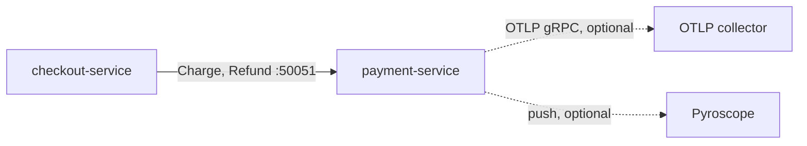

# Architecture

## Context



payment-service is a simulation: no payment provider is involved and nothing is persisted. It is stateless and calls no other service. Its only caller is checkout-service, which calls `Charge` and, when shipping fails after a charge, `Refund` (both checked in checkout's `origin/main` code on 2026-11-21).

## Charge and refund

```mermaid
sequenceDiagram
    participant CO as checkout-service
    participant PA as payment-service
    CO->>PA: Charge(amount, credit_card)
    Note over PA: validate card (Luhn, Visa or MasterCard, CVV, expiry), amount; test card decides the outcome
    PA-->>CO: transaction_id (random UUID v4) or an error "<reason>: <text>"
    Note over CO: shipping fails
    CO->>PA: Refund(transaction_id, amount)
    Note over PA: transaction not looked up; refund_id = UUID v5 of the transaction id
    PA-->>CO: refund_id
```

The outcome of a `Charge` is decided only by the documented test card numbers (see [API](api.md)); every other valid card succeeds. Card numbers and CVVs never reach a log line, an error message or a span attribute ([ADR 1](adr/0001-simulated-payments-keyed-on-test-cards.md)).

## Components

| File | Role |
|---|---|
| `src/server.ts` | gRPC server bootstrap, reflection, signal handling |
| `src/handlers.ts`, `charge.ts`, `refund.ts`, `money.ts`, `errors.ts` | the RPC handlers, card and amount validation, test-card outcomes, error mapping to `<reason>: <text>` |
| `src/clock.ts` | injected clock for the expiry check |
| `src/lifecycle.ts` | health state and the graceful shutdown (NOT_SERVING, drain, flush, exit) |
| `src/telemetry.ts`, `telemetry-config.ts`, `metrics.ts`, `logger.ts`, `fatal.ts` | OTel SDK, RPC and `payment_charges_total` metrics, pino JSON logs with redaction and trace ids, fatal handler |
| `proto/` | `payment.proto` and `health.proto`, loaded at runtime by `@grpc/proto-loader` |

## Decisions

[ADR 1](adr/0001-simulated-payments-keyed-on-test-cards.md).
